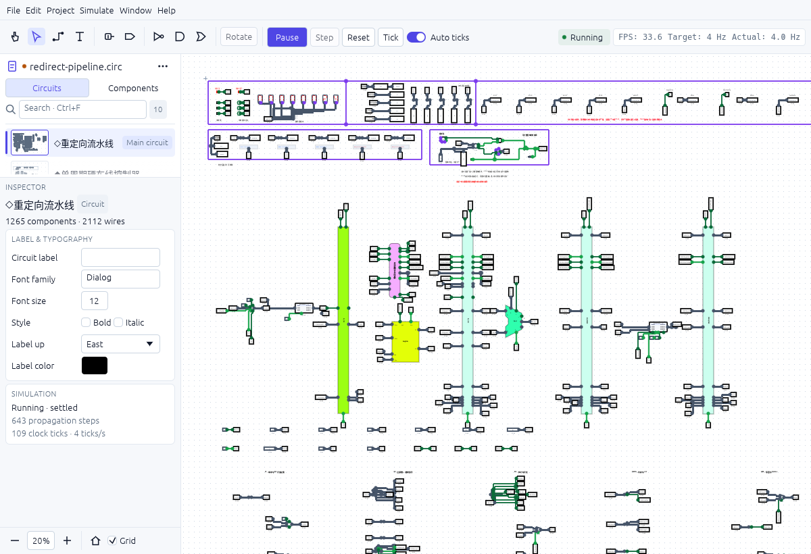

# logisim-rs

[English](README.md) | [简体中文](README.zh-CN.md)

[](https://www.rust-lang.org/)
[](https://github.com/Zebraine/logisim-rs/releases)

A cleanroom desktop digital logic editor and simulator built with Rust and egui.
It aims for practical compatibility with Logisim-ITA v2.16.2.2 for the features it implements, without using Java or the original implementation.

<p align="center">
  
  
</p>

## What you can do

- Build hierarchical circuits with subcircuits, custom appearances, and editable packaging.
- Generate combinational circuits from truth tables or expressions (up to 12/32 inputs and 32 outputs).
- Work with gates, wiring, arithmetic, plexers, sequential logic, memory, and I/O components.
- Simulate four-state circuits in stable or event-driven mode, with live wire values and signal colors.
- Read and write the implemented `.circ` subset; import ROM/RAM images in Logisim `v2.0 raw` `.hex` format.
- Use `.circ` libraries as editable snapshots and load components from Wasm plugins.
- Work in English or Simplified Chinese, with Light/Dark themes, three accents, two densities, and configurable shortcuts.
- Keep work safe with autosave, crash recovery, and optional one-generation `.bak` backups.
- Export the current canvas view as a PNG image.

## Get started

### Download and run

Download a package for your platform and its `.sha256` checksum from [Releases](https://github.com/Zebraine/logisim-rs/releases), verify it, and extract the archive completely before running.

| Platform | Start |
| --- | --- |
| Linux x86-64 | `./logisim-rs`; built on Ubuntu 24.04, requires Fontconfig and a working graphics driver |
| Windows x86-64 | `logisim-rs.exe` |
| macOS 15+ | Open `Logisim rs.app` (Apple Silicon). v0.2.0 no longer ships an Intel build. |

The Windows and macOS packages are not signed or notarized. UI validation for this release was performed on Linux X11; the other packages are built by the same release workflow but have not been manually UI-tested on their platforms.

Simplified Chinese text uses system fonts; install a CJK font such as Noto Sans CJK SC if needed.

### First circuit

1. Create a circuit from **File → New**, or open a `.circ` example.
2. Pick a component from the left catalogue, place it on the canvas, and edit its properties in the inspector.
3. Drag from a port, or from the middle of a wire, to connect components.
4. Select the Poke tool (`P`) to operate inputs and inspect signals.
5. Use **Step** / `Ctrl+I`, **Tick** / `Ctrl+T`, or **Automatic ticks** / `Ctrl+K` in the Simulate menu to advance time.
6. Save with `Ctrl+S`. The title bar shows whether the document has unsaved changes.

A tick is a simulation step, not necessarily a complete clock period. The automatic clock defaults to 4 Hz and can be changed in the Simulate menu.

Useful starting points:

- `V` Select, `P` Poke, `W` Wire, `T` Text, `U` Tunnel, `R` Rotate.
- `Ctrl+Z` / `Ctrl+Shift+Z` undo and redo.
- `Ctrl+F` searches the catalogue or settings, depending on the focused panel.
- **File → Settings** changes language, simulation mode, theme, density, editor defaults, autosave, and recovery behavior.
- **File → Print…** previews the current canvas and sends that image to the system default printer. Linux and macOS require `lp`. Windows uses the registered PNG print handler through PowerShell. Paper size, copies and other page settings follow the system defaults.
- **Settings → Editor** sets the family (Dialog, Monospace or Serif), size, bold and italic for new component labels. A remembered placement template keeps its edited font. The canvas uses its existing proportional face for Serif.
- Shortcuts can be rebound under **Settings → Shortcuts**.

## Plugins

logisim-rs uses a versioned Wasm plugin ABI for externally supplied components. A plugin can define its graphics, ports, properties, actions, and simulation behavior; the desktop host handles loading, validation, and integration with the project.

- Plugins are separate `.wasm` files and are not compiled into the desktop binary.
- A project records its plugin dependencies as source paths. Relative paths are resolved from the circuit directory first, with an absolute fallback.
- Missing dependencies can be located from **Project Options → Resolve missing…**. **Settings → Advanced → Plugin fallback directory** adds one optional same-name fallback directory for local modules.
- Plugin paths and definitions are validated before use. Missing or mismatched modules remain visibly unavailable instead of being silently replaced.
- The host does not execute Java or inspect JAR files.

Optional example modules and their source are kept under `plugins/` in the source repository and in release packages; they are examples, not a requirement for using the editor.

## Examples

The repository includes optional course CPU examples under [`examples/course/`](examples/course/). They share the course Wasm module and are intended as teaching material rather than a fixed benchmark suite.

Representative starting points include:

- [`single-cycle.circ`](examples/course/single-cycle.circ) — a single-cycle CPU.
- [`ideal-pipeline.circ`](examples/course/ideal-pipeline.circ) — an ideal pipelined CPU.
- [`redirect-pipeline.circ`](examples/course/redirect-pipeline.circ) — a pipelined CPU with redirect handling.
- [`dynamic-branch-prediction.circ`](examples/course/dynamic-branch-prediction.circ) — branch prediction.
- [`single-interrupt.circ`](examples/course/single-interrupt.circ) and [`nested-interrupt.circ`](examples/course/nested-interrupt.circ) — interrupt variants.

The examples illustrate the implemented behavior; they are not a compatibility test for every timing or exception detail. If you move an example, keep the relative layout between `examples/` and `plugins/`, or use the plugin locator.

## Compatibility

This is a practical cleanroom implementation, not a byte-for-byte clone of Logisim-ITA.

- The implemented `.circ` subset can be read and written. Unsupported content is reported and omitted, and the original source is protected against accidental overwrite.
- Imported `.circ` libraries are editable snapshots; they do not silently link back to the source library.
- Wasm components are a logisim-rs extension. Such circuits require this application and their plugin modules.
- Propagation timing, feedback resolution, and some advanced component behavior can differ from the reference program. Compatibility claims apply only to the behavior covered by the repository's tests and experiments.
- The host does not execute Java/JAR files.

## Build from source

Requirements: Rust 1.99 or newer (the repository pins 1.99.0 via `rust-toolchain.toml`) and the platform libraries needed by eframe/egui.

On Debian/Ubuntu, install the Linux build prerequisites first:

```sh
sudo apt-get update
sudo apt-get install -y pkg-config libfontconfig1-dev
```

Run the application from the workspace:

```sh
cargo run -p logisim-rs --release --locked
# Open an example at startup
cargo run -p logisim-rs --release --locked -- examples/course/redirect-pipeline.circ
```

Run the workspace checks:

```sh
cargo fmt --all -- --check
cargo check --workspace --all-targets --all-features --locked --offline
cargo clippy --workspace --all-targets --all-features --locked --offline -- -D warnings
cargo test --workspace --all-features --locked --offline
```

See [CONTRIBUTING.md](CONTRIBUTING.md) for the development and release workflow. Plugin source builds, ABI checks, and release packaging are documented in [.github/workflows/ci.yml](.github/workflows/ci.yml) and [.github/workflows/release.yml](.github/workflows/release.yml).

## Known limitations

- A Joystick's label font is not serialized in the existing `.circ` format; it keeps its intrinsic size of 12 after reopening, even if a different default label size is configured.
- In Dark mode, custom subcircuit artwork receives a contrast outline, but plugin interiors are drawn by the plugin author. The host only adds a boundary around the plugin component.
- The UI has been manually validated on Linux X11. Windows, macOS, and native Wayland have not been manually UI-tested in this release.

## License

Original code is released under the [MIT License](LICENSE).
