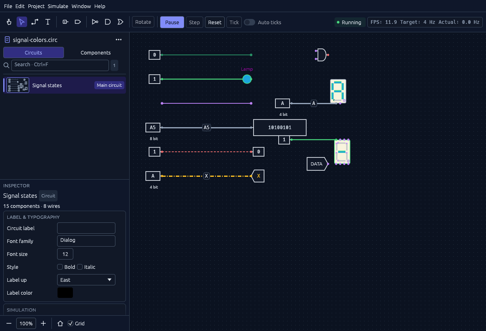

# logisim-rs

[English](README.md) | [简体中文](README.zh-CN.md)

[](https://www.rust-lang.org/)
[](https://github.com/Zebraine/logisim-rs/releases)

A cleanroom desktop digital logic editor and simulator built with Rust and egui.
Legacy projects from the supported Logisim-ITA v2.16.2.2 subset can be opened and edited.

<p align="center">
  
  
</p>

## What you can do

- Build hierarchical circuits with subcircuits, custom appearances, and editable packaging.
- Generate combinational circuits from truth tables or expressions (up to 12/32 inputs and 32 outputs).
- Work with gates, wiring, arithmetic, plexers, sequential logic, memory, and I/O components.
- Simulate four-state circuits in stable or event-driven mode, with live wire values and signal colors.
- Read and write the implemented `.circ` subset; import ROM/RAM images in Logisim `v2.0 raw` `.hex` format.
- Use `.circ` libraries as editable snapshots and load components from Wasm plugins.
- Work in English or Simplified Chinese, with Light/Dark themes, three accents, two densities, and configurable shortcuts.
- Keep work safe with autosave, crash recovery, and optional one-generation `.bak` backups.
- Export the current canvas view as a PNG image.

## Get started

### Download and run

Download a package for your platform and its `.sha256` checksum from [Releases](https://github.com/Zebraine/logisim-rs/releases), verify it, and extract the archive completely before running.

| Platform | Start |
| --- | --- |
| Linux x86-64 | `./logisim-rs`; built on Ubuntu 24.04, requires Fontconfig and a working graphics driver |
| Windows x86-64 | `logisim-rs.exe`; `logisim-agent.exe` for the headless CLI/MCP service |
| macOS 15+ | Open `Logisim rs.app` (Apple Silicon); `./logisim-agent` for the headless CLI/MCP service |
| All packages | The headless `logisim-agent` binary is included; Linux uses `./logisim-agent`. |

The Windows and macOS packages are not signed or notarized. UI validation for this release was performed on Linux X11; the other packages are built by the same release workflow but have not been manually UI-tested on their platforms.

Simplified Chinese text uses system fonts; install a CJK font such as Noto Sans CJK SC if needed.

### First circuit

1. Create a circuit from **File → New**, or open a `.circ` example.
2. Pick a component from the left catalogue, place it on the canvas, and edit its properties in the inspector.
3. Drag from a port, or from the middle of a wire, to connect components.
4. Select the Poke tool (`P`) to operate inputs and inspect signals.
5. Use **Step** / `Ctrl+I`, **Tick** / `Ctrl+T`, or **Automatic ticks** / `Ctrl+K` in the Simulate menu to advance time.
6. Save with `Ctrl+S`. The title bar shows whether the document has unsaved changes.

A tick is a simulation step, not necessarily a complete clock period. The automatic clock defaults to 4 Hz and can be changed in the Simulate menu.

Useful starting points:

- `V` Select, `P` Poke, `W` Wire, `T` Text, `U` Tunnel, `R` Rotate.
- `Ctrl+Z` / `Ctrl+Shift+Z` undo and redo.
- `Ctrl+F` searches the catalogue or settings, depending on the focused panel.
- **File → Settings** changes language, simulation mode, theme, density, editor defaults, autosave, and recovery behavior.
- **File → Print…** previews the current canvas and sends that image to the system default printer. Linux and macOS require `lp`. Windows uses the registered PNG print handler through PowerShell. You can cancel while the print command is running. The app stops it after 20 seconds. Jobs already accepted by the printer can be cancelled from the system print queue. Paper size, copies and other page settings follow the system defaults.
- **Settings → Editor** sets the family (Dialog, Monospace or Serif), size, bold and italic for new component labels. A remembered placement template keeps its edited font. The canvas uses a system serif face for Serif. If none is available, it uses the proportional font and logs a warning at startup.
- Shortcuts can be rebound under **Settings → Shortcuts**.

## Plugins

logisim-rs uses a versioned Wasm plugin ABI for externally supplied components. A plugin can define its graphics, ports, properties, actions, and simulation behavior; the desktop host handles loading, validation, and integration with the project.

- Plugins are separate `.wasm` files and are not compiled into the desktop binary.
- A project records its plugin dependencies as source paths. Relative paths are resolved from the circuit directory first, with an absolute fallback.
- Missing dependencies can be located from **Project Options → Resolve missing…**. **Settings → Advanced → Plugin fallback directory** adds one optional same-name fallback directory for local modules.
- Plugin paths and definitions are validated before use. Missing or mismatched modules remain visibly unavailable instead of being silently replaced.
- The host does not execute Java or inspect JAR files.

Optional example modules and their source are kept under `plugins/` in the source repository and in release packages; they are examples, not a requirement for using the editor.

The desktop uses wasmi by default. A build made with `cargo build --release -p logisim-rs --features wasmtime-experimental` also offers **Settings → Advanced → Wasm plugin engine**. Confirm Wasmtime and restart the desktop to use it. The panel shows the engine running in this process. Initial module compilation can be substantially slower. With the same 10M fuel budget a plugin may finish in wasmi and pause in Wasmtime. The desktop compiles from Wasm without a persistent native cache. Windows and macOS execution of this option has not been verified.

## Examples

The repository includes optional course CPU examples under [`examples/course/`](examples/course/). They share the course Wasm module and are intended as teaching material rather than a fixed benchmark suite.

Representative starting points include:

- [`single-cycle.circ`](examples/course/single-cycle.circ) — a single-cycle CPU.
- [`ideal-pipeline.circ`](examples/course/ideal-pipeline.circ) — an ideal pipelined CPU.
- [`redirect-pipeline.circ`](examples/course/redirect-pipeline.circ) — a pipelined CPU with redirect handling.
- [`dynamic-branch-prediction.circ`](examples/course/dynamic-branch-prediction.circ) — branch prediction.
- [`single-interrupt.circ`](examples/course/single-interrupt.circ) and [`nested-interrupt.circ`](examples/course/nested-interrupt.circ) — interrupt variants.

The repository also contains a small [agent-built showcase](examples/agent/README.md) created through the headless CLI: a counter, an adder, and a plugin register-file circuit. The builder script records the exact edits, simulation results and plugin action.

The examples illustrate the implemented behavior; they are not a compatibility test for every timing or exception detail. If you move an example, keep the relative layout between `examples/` and `plugins/`, or use the plugin locator.

## Legacy projects

The Logisim-ITA compatibility scope is frozen. New features follow logisim-rs specifications. The supported `.circ` subset remains readable and writable for migration. Import reports unsupported content and protects the original against overwrite. Imported libraries remain editable snapshots. Wasm components require their matching modules. External editors may discard extension attributes such as `agent-id` when resaving.

The planned native project format is `.lrs` (UTF-8 JSON). This version still saves `.circ`. Once the native format passes acceptance, Save and Save As will default to `.lrs`. Existing `.circ` files will remain readable and writing `.circ` will require an explicit format choice.

## Build from source

Requirements: Rust 1.99 or newer (the repository pins 1.99.0 via `rust-toolchain.toml`) and the platform libraries needed by eframe/egui.

On Debian/Ubuntu, install the Linux build prerequisites first:

```sh
sudo apt-get update
sudo apt-get install -y pkg-config libfontconfig1-dev
```

Run the application from the workspace:

```sh
cargo run -p logisim-rs --release --locked
# Open an example at startup
cargo run -p logisim-rs --release --locked -- examples/course/redirect-pipeline.circ
```

Run the workspace checks:

```sh
cargo fmt --all -- --check
cargo check --workspace --all-targets --all-features --locked --offline
cargo clippy --workspace --all-targets --all-features --locked --offline -- -D warnings
cargo test --workspace --all-features --locked --offline
```

See [CONTRIBUTING.md](CONTRIBUTING.md) for the development and release workflow. Plugin source builds, ABI checks, and release packaging are documented in [.github/workflows/ci.yml](.github/workflows/ci.yml) and [.github/workflows/release.yml](.github/workflows/release.yml).

## Headless agent

Release packages include the headless `logisim-agent` binary. Build it from source with `cargo build --release --locked -p logisim-agent`. For production MCP clients, use `logisim-agent` with the arguments `--root /work/project mcp`. The same root can be used in the JSON CLI.

```sh
logisim-agent --root /work/project mcp
logisim-agent --root /work/project project open --path example.circ
logisim-agent --root /work/project settings get --config preferences.json
logisim-agent project catalog
logisim-agent settings catalog
logisim-agent settings get --config /path/to/preferences.json
logisim-agent settings patch --config /path/to/preferences.json --ops edits.json --dry-run
```

Choose an existing directory managed by trusted local processes. With `--root`, relative project, configuration and CLI `--ops` paths start there. The agent checks absolute paths, symbolic links and save sidecars before file I/O. An escape returns `path_outside_root`. Without the option, relative paths start in the working directory and absolute paths are unrestricted. Plugin dependencies recorded in a project follow the project's existing resolution rules.

MCP negotiates `2024-11-05`, `2025-03-26`, `2025-06-18` and `2025-11-25`. It returns the requested revision when supported and offers `2025-11-25` otherwise. In `tools/call`, read `result.isError` for the tool outcome. Both `structuredContent` and the JSON text in `content[0].text` carry the CLI envelope, including the error code and details on failure. Malformed requests, unknown tools and handshake errors use top-level JSON-RPC errors. A one-shot CLI command prints a top-level `ok:false` envelope and exits unsuccessfully on failure.

An edits file such as `{"ops":[{"key":"appearance.theme","value":"dark"}]}` changes portable v17 preferences. Set `expected_sha256` to the `source_sha256` from the get response to require that exact revision. Use `--apply` to commit. The desktop and agent coordinate atomic updates using a sibling `.lock` file. Recent files, window geometry, panel layout and the local plugin directory stay in the host configuration.

`plugins.wasm_engine` stores the desktop preference (`wasmi` or `wasmtime`). The Agent always executes plugins using wasmi, including in experimental builds. `simulation_state.wasm_engine` identifies the plugin runtime, and `engine` identifies circuit propagation. Settings responses also report `agent_wasm_engine`.

For a circuit, run `logisim-agent cli` and send one JSON object per line in the same process. Each process can hold 64 open project sessions. At the limit, `project_open` returns `session_limit`. Use `project_close` to free a slot.

MCP executes requests in arrival order within each project session. Independent sessions can run concurrently. Match replies by JSON-RPC ID. Settings operations and CLI line requests execute sequentially.

```jsonl
{"tool":"project_open","arguments":{"path":"examples/course/single-cycle.circ"}}
{"tool":"project_snapshot","arguments":{"session":"ID_FROM_OPEN"}}
{"tool":"simulation_open","arguments":{"session":"ID_FROM_OPEN"}}
{"tool":"simulation_state","arguments":{"session":"ID_FROM_OPEN"}}
{"tool":"project_close","arguments":{"session":"ID_FROM_OPEN"}}
```

Use the returned `data.session_id` in subsequent requests. CLI and MCP expose the same 19 operations. After the MCP handshake, use `tools/list` to get their names and input schemas. The project snapshot covers every circuit definition. Simulation state includes signals from the active root instance, clock and propagation counters, diagnostics and plugin status.

### Controlling a simulation

Open the simulation with `mode` set to `auto` (default), `stable` or `event`. Auto and Stable try compiled propagation and report a preflight fallback in `fallback_reason`. A runtime fault pauses execution. Opening the same session again returns `created:false` and its current mode and state. Saving the project retains the simulation. An applied project change invalidates it, and closing the session releases it.

Send these argument arrays on stdin to the same running `logisim-agent cli` process.

```jsonl
["simulation","open","--session","ID_FROM_OPEN","--mode","event"]
["simulation","enable","--session","ID_FROM_OPEN","--enabled","false"]
["simulation","set-input","--session","ID_FROM_OPEN","--id","1","--value","1"]
["simulation","step","--session","ID_FROM_OPEN"]
["simulation","settle","--session","ID_FROM_OPEN"]
["simulation","tick","--session","ID_FROM_OPEN"]
```

Use an input ID from the root circuit. Input Pins, Switches and DipSwitches accept unsigned values within their control width. Three-state input Pins also accept `--unknown`. Enabled inputs propagate immediately. Pausing leaves pending work for a single event batch (`step`), full propagation (`settle`) or resumption (`enable --enabled true`). A tick requires a settled network and advances exactly once, including propagation. A clockless hierarchy returns `no_clocks`, and pending work returns `not_settled`. Only an explicit tick advances the clock. Reset restores initial signals and reports zero ticks and steps at the settled reset boundary. Each successful control returns `action`, `changed` and the resulting `state`.

For a root plugin instance, read the action ID, label and argument hint from `tool.actions` in `project_snapshot`. With the simulation open, pass exactly one component reference (`id` or `agent_id`) to `simulation_plugin_action`. For example, the course Register File accepts the register address in decimal and the word in hexadecimal:

```jsonl
["simulation","plugin-action","--session","ID_FROM_OPEN","--agent-id","COMPONENT_AGENT_ID","--action","write","--argument","1 DEADBEEF"]
```

The optional argument is literal UTF-8 text of at most 1024 bytes and defaults to an empty string. Actions without an argument hint accept only the empty string. Actions run in the agent session’s own simulation, independently of any open desktop window. Keyboard bindings and `InputEvent` delivery are available only in the interactive editor. A successful call returns `action:"plugin_action"`, `changed` and the full simulation state. A change to private plugin state counts even when the output pins hold the same values. While paused, the action executes and queued signals remain in `pending_count` until an explicit propagation or resume. The tick count and project bytes stay intact. Invalid targets, actions or arguments leave the simulation as it was. A plugin execution fault returns `plugin_error` with the paused state in `error.details.state`. Use `simulation_reset` to recover.

### Editing a project session

Pass `project_patch` a `session`, an explicit `dry_run` boolean, and an ordered `ops` array. A preview returns provisional IDs. Applying the same batch to the same session state returns the same IDs. A failed operation rolls the whole batch back and reports its zero-based `error.details.op_index`. A committed edit invalidates the previous simulation observation. Call `simulation_open` again to observe the edited project.

```jsonl
{"tool":"project_patch","arguments":{"session":"ID_FROM_OPEN","dry_run":true,"ops":[{"op":"update_component","circuit":1,"id":12,"properties":{"label":"A","facing":"west"}}]}}
{"tool":"project_patch","arguments":{"session":"ID_FROM_OPEN","dry_run":false,"ops":[{"op":"update_component","circuit":1,"id":12,"properties":{"label":"A","facing":"west"}}]}}
{"tool":"project_save","arguments":{"session":"ID_FROM_OPEN","expected_sha256":"SHA_FROM_OPEN_OR_LAST_SAVE","backup":true}}
```

Use IDs from your snapshot. After reviewing the preview, repeat the patch with `dry_run:false`, then save. The `project_patch` input schema describes the operations for circuits, wires and components, including `add_plugin` and `update_plugin` for Wasm instances. Port positions use canvas coordinates, colors use RGBA and Splitter mappings use zero-based branch indices or null. Include `circuit` when a numeric item ID occurs in multiple circuits. Wire edits use the editor's routing and normalization rules.

Run `logisim-agent project catalog` or call the MCP tool `project_catalog` with no arguments to discover component kinds before opening a file. The response’s `data.kinds` lists core names, accepted aliases, and the `addable`, `editable` and `requires_circuit_id` flags. Only subcircuit instances need a target circuit ID. The plugin entry has `requires_plugin_source:true` and takes its properties from the selected module and tool.

For a statically addable kind, the snapshot’s `property_schema` matches the catalog entry’s `properties`. It describes enum codes, integer bounds, RGBA channels, nullable Splitter branches and partial font objects. String fields with a byte limit report it in `x-maxUtf8Bytes`. The completed component must also satisfy relationships between fields, such as a Counter maximum fitting its width. Snapshots retain `patchable_properties`, `property_types` and current values under their original keys. Add and update accept the same properties. A partial `font` object changes only its supplied members.

| Editable family | Properties specific to the family |
| --- | --- |
| Pin, Gate, Parity, Probe, Tunnel, Splitter | Width, input configuration, radix or branch mapping, as listed in the snapshot |
| Constant, Ground, Power, Pull Resistor | `bits` on the sources, unsigned `value` within the Constant’s width, resistor `pull` of `0`, `1` or `X` (strings) |
| Button, Switch, DipSwitch, Clock | Switch `bits`, DIP `switch_count`, clock `high_ticks` and `low_ticks` (1–65535), label placement |
| Text, Bit Extender | `text`, `font`, RGBA `color`, `halign` (left/center/right), `valign` (top/center/base/bottom). Extender `in_width`, `out_width`, `type` (zero/one/sign/input) |
| Shifter, Adder, Comparator | `bits`, shifter `shift` (logical_left/logical_right/arithmetic_right/rotate_left/rotate_right), comparator `signed` |
| Multiplexer, Demultiplexer, Decoder | `select_bits` (1–5), `enable`, `top_right`, `disabled_zero`, data `bits` on mux/demux, `three_state` on demux/decoder |
| Subtractor, Multiplier, Divider, Negator, Bit Adder, Bit Finder | `bits` (1–32), Bit Adder `bit_inputs` (1–32), Bit Finder `search` (lowest_one/highest_one/lowest_zero/highest_zero) |
| Priority Encoder, Bit Selector, 7-Segment Display Decoder | Encoder `select_bits`, `disabled_zero`, `no_input_zero`. Selector `bits`, `group_bits` (1–32), `top_right`. Display Decoder `multibit` |
| Controlled Buffer / Inverter, Transistor, Transmission Gate | `bits` and facing. Controlled gates use `control_left` and `negate_control`, with `size` (narrow/wide) on the inverter. Transistors and transmission gates use `gate_bottom_right`, with `transistor_type` (p/n) on the transistor |
| D, T, J-K, S-R Flip-Flops and D, S-R Latches | `trigger` (flip-flops rising/falling, latches high/low, S-R latch also accepts latch for operation without enable), `controls` (above_below/below_above/legacy), `negate_controls`, `new_layout`. Old flip-flop layouts require legacy controls |
| Register, Counter, Shift Register, Random Generator | `bits` and `trigger` (rising/falling, register also high/low). Register `select_high`, Counter `counter_max`, `counter_overflow` (wrap/stay/continue/load), `counter_old`, Random Generator signed 32-bit `random_seed` |
| LED, SevenSegment, HexDisplay, RGBLED, DotMatrix | Applicable RGBA colors and polarity, RGB `multibit`, matrix rows/columns (1–32), `matrix_input` (column/row/select), circular dots and persistence |
| ROM, RAM | `bits` (1–32), `address_bits` (2–24), `select_high` and label attributes. ROM has `contents`. RAM has `interface` (shared_sync/shared_async/separate) and `simple`. RAM words belong to the simulation instance |
| PLA ROM | `inputs`, `terms`, `outputs` (1–32 each), `input_plane`, `output_plane`, `select_high` and label attributes |
| Slider, Joystick | Slider `bits` (1–32), `slider_reverse`, unsigned `slider_value` within the final width, facing, label, font and color. Joystick `facing` and `bits` (2–5) |
| Keyboard, TTY | Both accept `bits` of 7 or 16 and `trigger` of rising/falling. Keyboard `buffer_len` is 1–256. TTY provides `rows` (1–48), `columns` (1–120) and RGBA `on_color` and `background` |

ROM `contents` replaces the complete image with at most 65,536 strictly increasing `[address, word]` boundaries. Each word continues to the next boundary or the end of memory. For example, `[[2,7],[5,0]]` sets addresses 2 through 4 to 7. Other words are zero. An empty array clears the image. Changing only the dimensions uses the core resize rule, which drops addresses outside the new capacity and masks words to the new width. Snapshotting an existing ROM above the boundary limit returns `too_large`.

PLA planes have one row per term. Input cells are `disconnected`, `direct` or `inverted`. Output cells are booleans. Supplied planes must match the final dimensions. Resizing preserves overlapping cells and returns both complete planes in the patch result.

For a subcircuit, pass the owning circuit and the existing target definition separately, for example `{"op":"add_component","circuit":1,"kind":"subcircuit","circuit_id":2,"position":[100,100]}`. You can substitute the target definition’s `circuit_agent_id` for `circuit_id`. The owning `circuit` stays numeric. Its snapshot includes the target name and pin bindings in `circuit_name` and `interface_ports`. Edit its label, font, facing or position. Editing the target Pins updates instance interfaces. Recursive references and removal of a referenced definition are rejected.

Storage patches edit the document attributes. Use the simulation tools for live state. When narrowing a Counter below its current maximum, supply a fitting `counter_max` in the same operation.

For CLI flags, put `{"ops":[...],"expected_sha256":"..."}` in an edits file (the hash is optional). A running `logisim-agent cli` or `project open` process also accepts argument arrays on stdin:

```jsonl
["project","patch","--session","ID_FROM_OPEN","--ops","edits.json","--dry-run"]
["project","patch","--session","ID_FROM_OPEN","--ops","edits.json","--apply"]
["project","save","--session","ID_FROM_OPEN","--expected-sha256","SHA_FROM_OPEN_OR_LAST_SAVE"]
```

Only explicit save writes the original path. It checks the current file against the session's last disk SHA even when the caller omits the hash. By default it atomically rotates the original bytes to `<file>.bak`. Use `--no-backup` or `backup:false` to skip rotation. A backup failure stops the save. A later target-write failure may leave a complete backup. Agent writers coordinate on a persistent empty `<file>.lock` sidecar. Partial imports are read-only. Saving preserves the current numeric IDs. Reopening allocates numeric IDs for the new session.

#### Persistent object IDs

Each circuit, component and wire in `project_snapshot` has a persistent `agent_id` alongside its numeric `id`. For example, a Pin snapshot includes `{"id":3,"agent_id":"c-0123456789abcdef0123456789abcdef","kind":"Pin"}`. Pass exactly one of `id` and `agent_id` when moving, updating or removing a component, removing a wire, updating a plugin instance, or renaming, removing or setting the main circuit. Across sessions, use the saved `agent_id` directly. If you also supply `circuit`, it must match the owner. A new snapshot maps each persistent ID to its current numeric ID.

For example, `{"op":"update_component","agent_id":"c-0123456789abcdef0123456789abcdef","properties":{"label":"DATA"}}` updates that Pin even if its numeric ID changed on reopen. Each addition returns both IDs in its change. After wire normalization, `wire_ids` and `wire_agent_ids` list surviving segments in matching order. The first pair is the primary `id` and `agent_id`. If the same batch removes the wire or its circuit, the addition reports its creation IDs and empty segment lists. Repeating a dry-run or applying the same batch to the same session state gives the same IDs.

The optional XML attribute `agent-id` is a logisim-rs extension. Its value has a type prefix (`k-` circuit, `c-` component, `w-` wire) followed by 32 lowercase hexadecimal digits. Opening an older file allocates missing IDs in memory. The next explicit save writes them to the project, and a copy of that file carries the same IDs. The backup contains the original bytes. New split segments get fresh IDs, and a merged wire retains one surviving identity.

An invalid ID or a repeated occurrence produces a warning. The first valid occurrence is retained, and the agent assigns fresh IDs to the affected objects. These repairs can be saved when the import has no omissions. External tools may ignore or discard the attribute, including on resave. Its handling by Logisim-ITA has not been verified.

#### Wasm plugin instances

Run `logisim-agent plugin catalog --wasm plugins/input/input.wasm` or call `plugin_catalog` with `{"path":"plugins/input/input.wasm"}` to inspect the manifest, ports, actions and property defaults. For each tool, `properties` describes the Boolean, Integer and Choice controls. Its `property_schema` describes the strings accepted in a patch. For example, a queue capacity of eight is `"8"`. The same schema appears in a loaded instance's snapshot.

This batch places a keyboard in circuit 1, using a module path relative to the project file. A successful patch returns the new instance’s `id` and `agent_id` in `changes[0]`.

```json
{"ops":[{"op":"add_plugin","circuit":1,"position":[100,100],"tool":"keyboard","source":{"plugin":"org.logisim-rs.input","version":"1.0.0","path":"plugins/input/input.wasm"},"properties":{"capacity":"8"}}]}
```

For another instance of a recorded dependency, omit `source` and supply its top-level `plugin` and `version`. With `--root`, both caller-supplied source paths and the catalog path must stay inside the root. Previously recorded dependencies retain project-relative resolution with an absolute fallback. An alternate location for an already recorded identity must provide the same tool definition. The project keeps its original source.

Pass the returned ID to `update_plugin` to edit individual `properties` or the document fields `label`, `facing`, `font` and opaque RGBA `color`. Use `move_component` and `remove_component` for placement and removal. Removing the last instance retains the project dependency. If a module is unavailable or disagrees with a saved definition, the snapshot includes `plugin_error`. Its saved property values remain readable and the instance can still be moved or removed. Failed patches roll back the whole batch. Use `simulation_plugin_action` to invoke a root instance’s runtime action.

## Known limitations

- A Joystick's label font is not serialized in the existing `.circ` format; it keeps its intrinsic size of 12 after reopening, even if a different default label size is configured.
- In Dark mode, custom subcircuit artwork receives a contrast outline, but plugin interiors are drawn by the plugin author. The host only adds a boundary around the plugin component.
- Print uses the system default printer. Physical paper output and the Windows/macOS print handlers were not verified in this release; jobs already accepted by the print queue must be cancelled there.
- The headless agent was smoke-tested on Linux x86-64; the Windows/macOS agent binaries are built by the same workflow but have not been manually exercised on those platforms.
- The UI has been manually validated on Linux X11. Windows, macOS, and native Wayland have not been manually UI-tested in this release.

## License

Original code is released under the [MIT License](LICENSE).
