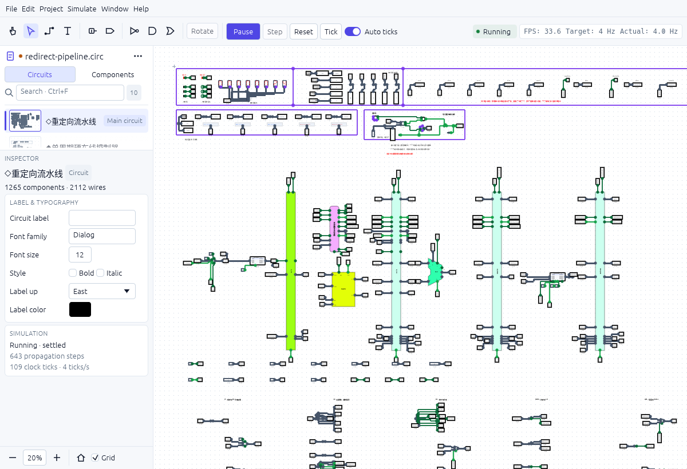
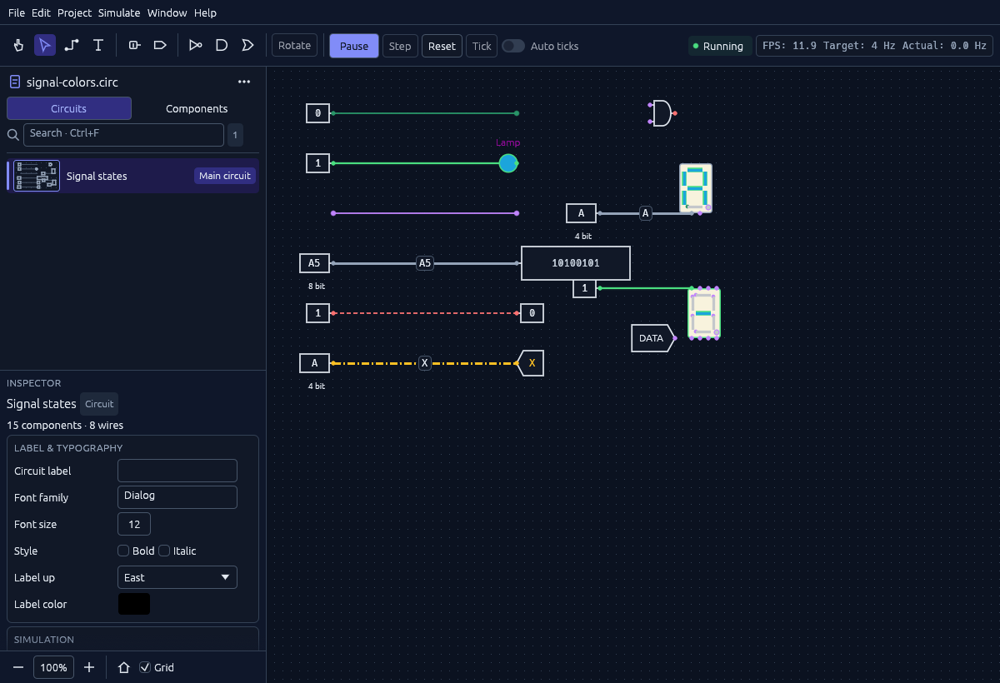

# logisim-rs

[English](README.md) | [简体中文](README.zh-CN.md)

[](https://www.rust-lang.org/)
[](https://github.com/Zebraine/logisim-rs/releases)

基于 Rust + egui 的桌面数字逻辑电路编辑与仿真工具。
以 Logisim-ITA v2.16.2.2 的实际运行行为为参考，对已实现的功能追求实用兼容，不依赖 Java，也不使用原实现的源码。

<p align="center">
  
  
</p>

## 可以做什么

- 编辑层次化电路：子电路、自定义外观、可编辑封装。
- 从真值表或表达式生成组合电路；真值表最多 12 输入，表达式最多 32 输入，均支持 32 输出。
- 使用门电路、布线、算术、Plexers、时序、存储器和输入/输出元件。
- 四态、层次化仿真，支持稳定态或事件传播模式，并实时显示导线值与信号颜色。
- 读写已实现的 `.circ` 子集；导入 ROM/RAM 的 Logisim `v2.0 raw` `.hex` 文件。
- 将 `.circ` 库作为可编辑快照导入，并从 Wasm 插件加载元件。
- 英语、简体中文；浅色/深色主题，三种强调色，两种密度，可改绑的快捷键。
- 自动保存、崩溃恢复、可选的单代 `.bak` 保存前备份。
- 将当前画布视口导出为 PNG 图片。

## 开始使用

### 下载与运行

从 [Releases](https://github.com/Zebraine/logisim-rs/releases) 下载对应平台包和 `.sha256` 校验文件，校验后完整解压再运行。

| 平台 | 启动方式 |
| --- | --- |
| Linux x86-64 | `./logisim-rs`；基于 Ubuntu 24.04 构建，需要 Fontconfig 和可用的图形驱动 |
| Windows x86-64 | `logisim-rs.exe` |
| macOS 15+ | 打开 `Logisim rs.app`（Apple Silicon）。v0.2.0 不再提供 Intel 包。 |

Windows/macOS 包未签名或公证。本版本的界面实机验证在 Linux X11 上完成；其他平台包由同一发布流程构建，但尚未在对应系统上人工验证界面。

中文显示依赖系统字体；如有缺字，可安装 Noto Sans CJK SC 等 CJK 字体。

### 第一个电路

1. 用 **File → New** 新建电路，或打开一个 `.circ` 示例。
2. 从左侧目录选择元件，放到画布上，在检查器中编辑属性。
3. 从元件端口或导线中段拖出连线。
4. 选择 Poke 工具（`P`）操作输入、查看信号。
5. 在 Simulate 菜单使用 **单步** / `Ctrl+I`、**时钟步进** / `Ctrl+T` 或 **自动时钟** / `Ctrl+K` 推进时间。
6. 用 `Ctrl+S` 保存。标题栏会显示是否有未保存修改。

一个 tick 是仿真步进，不一定等于完整时钟周期。自动时钟默认 4 Hz，可在 Simulate 菜单调整。

常用起点：

- `V` 选择，`P` 交互，`W` 连线，`T` 文字，`U` 隧道，`R` 旋转。
- `Ctrl+Z` / `Ctrl+Shift+Z` 撤销、重做。
- `Ctrl+F` 按当前焦点搜索目录或设置。
- **File → Settings** 可切换语言、仿真模式、主题、密度、编辑器默认值、自动保存和恢复行为。
- **文件 → 打印…** 可预览当前画布，确认后将预览图发送至系统默认打印机。Linux 和 macOS 需要 `lp`，Windows 通过 PowerShell 调用已注册的 PNG 打印程序。纸张、份数及其他页面选项沿用系统默认值。
- **设置 → 编辑器** 可为新元件标签设置字体（界面字体、等宽或衬线）、字号、粗体和斜体。已记住的放置模板保留手工设置的字体。画布使用系统衬线字体显示 Serif。找不到可用衬线字体时，使用比例字体并在启动日志中记录一次警告。
- 快捷键可在 **Settings → Shortcuts** 中改绑。

## 插件系统

logisim-rs 使用带版本号的 Wasm 插件 ABI 提供外部元件。插件可以定义图形、端口、属性、动作和仿真行为；桌面宿主负责加载、校验，并接入项目。

- 插件是独立的 `.wasm` 文件，不编译进桌面二进制。
- 项目将插件依赖记录为来源路径；相对路径优先从电路目录解析，绝对路径作为备用。
- 缺失依赖可在 **Project Options → Resolve missing…** 中补选。**Settings → Advanced → Plugin fallback directory** 可为本机模块增加一个可选的同名兜底目录。
- 使用前会校验插件路径和元件定义；缺失或不匹配的模块会明确保留为不可用状态，不会被静默替换。
- 宿主不执行 Java，也不读取 JAR 内部实现。

源码仓库和发布包在 `plugins/` 下附带可选的示例模块及源码；它们是示例，不是使用编辑器的前提。

## 示例

仓库在 [`examples/course/`](examples/course/) 中提供可选的课程 CPU 示例。它们共用课程 Wasm 模块，定位是教学材料，而不是固定基准套件。

有代表性的起点：

- [`single-cycle.circ`](examples/course/single-cycle.circ) — 单周期 CPU。
- [`ideal-pipeline.circ`](examples/course/ideal-pipeline.circ) — 理想流水线 CPU。
- [`redirect-pipeline.circ`](examples/course/redirect-pipeline.circ) — 带重定向处理的流水线 CPU。
- [`dynamic-branch-prediction.circ`](examples/course/dynamic-branch-prediction.circ) — 动态分支预测。
- [`single-interrupt.circ`](examples/course/single-interrupt.circ) 与 [`nested-interrupt.circ`](examples/course/nested-interrupt.circ) — 中断变体。

示例用于演示已实现行为，并不是所有时序或异常细节的兼容性证明。移动示例时请保留 `examples/` 与 `plugins/` 的相对目录，或使用插件补选功能。

## 兼容范围

这是一个实用的 Cleanroom 实现，不是逐字节复刻 Logisim-ITA。

- 已实现的 `.circ` 子集可以读写；不支持的内容会报告并省略，同时保护原文件不被误覆盖。
- 导入的 `.circ` 库是可编辑快照，不会静默回链到源库。
- Wasm 元件是 logisim-rs 的扩展；这类电路需要本程序和对应插件模块。
- 传播时序、反馈收敛和部分高级元件行为可能与参考程序不同。兼容性只覆盖仓库测试和实验实际验证过的范围。
- 宿主不执行 Java/JAR 文件。

## 从源码构建

需要 Rust 1.99 或更新版本（仓库通过 `rust-toolchain.toml` 固定 1.99.0），以及 eframe/egui 所需的平台库。

Debian/Ubuntu 先安装 Linux 构建依赖：

```sh
sudo apt-get update
sudo apt-get install -y pkg-config libfontconfig1-dev
```

在工作区运行：

```sh
cargo run -p logisim-rs --release --locked
# 启动时打开示例
cargo run -p logisim-rs --release --locked -- examples/course/redirect-pipeline.circ
```

运行工作区检查：

```sh
cargo fmt --all -- --check
cargo check --workspace --all-targets --all-features --locked --offline
cargo clippy --workspace --all-targets --all-features --locked --offline -- -D warnings
cargo test --workspace --all-features --locked --offline
```

开发、检查和发布流程见 [CONTRIBUTING.md](CONTRIBUTING.md)。插件构建、ABI 校验和发布打包见 [.github/workflows/ci.yml](.github/workflows/ci.yml) 与 [.github/workflows/release.yml](.github/workflows/release.yml)。

## 已知限制

- Joystick 的标签字体不写入现有 `.circ` 格式；重开后保持固有字号 12，即使配置了其他默认标签字号。
- 深色模式下，自定义封装会增加对比度轮廓；插件内部仍由插件作者绘制，宿主只增加元件外围边界。
- 界面在 Linux X11 上做过人工验证；本版本尚未在 Windows、macOS 和原生 Wayland 上人工验证界面。

## 许可证

原创代码采用 [MIT](LICENSE)。
